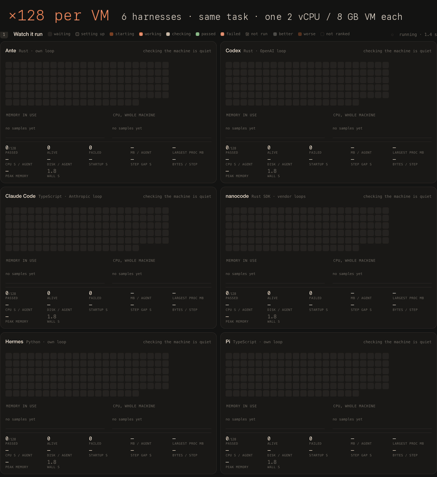
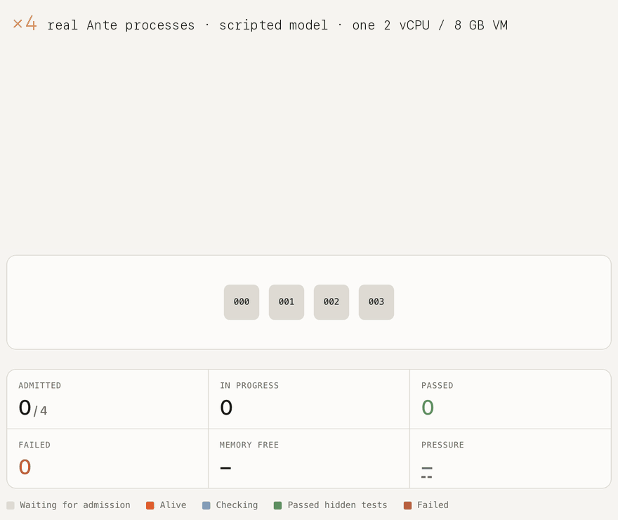
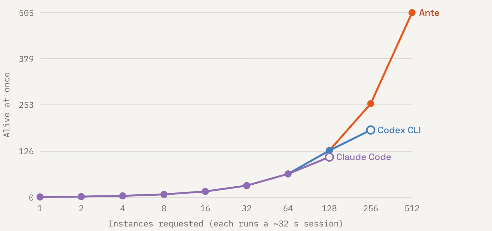
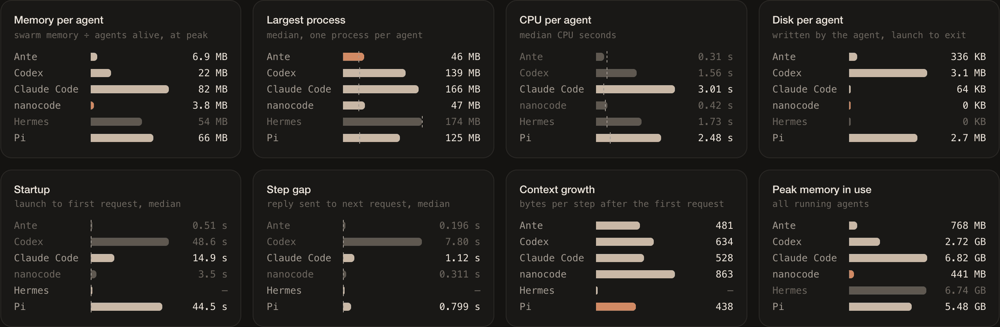
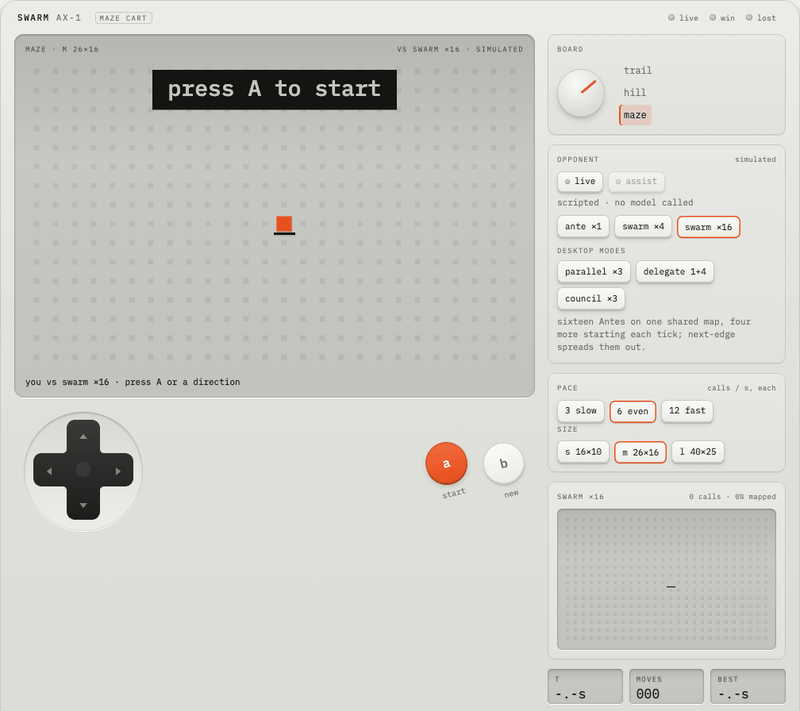

# ante-swarm-bench

Run many coding-agent CLIs at once on one machine and watch what each one costs.

Experimental. Python 3.11+ standard library, no dependencies, no build step.

<p align="center">
  
</p>

## Try it

```sh
cd swarm
PYTHONPATH=src python3 -m swarm plan examples/smoke-mini.toml -o /tmp/swarm-plan.json
PYTHONPATH=src python3 -m swarm run /tmp/swarm-plan.json -o /tmp/swarm-smoke
PYTHONPATH=src python3 -m swarm verify /tmp/swarm-smoke      # report: /tmp/swarm-smoke/report.html

PYTHONPATH=src python3 -m swarm solo --data /tmp/swarm-empty --static front-solo --maze front-maze
# http://127.0.0.1:8000/  ·  /hill/  ·  /maze/
```

No model calls, no credentials. Swap in `examples/smoke.toml` or `examples/density-*.toml` to run real agent CLIs.

## Pictures

<p align="center">
  <picture>
    <source media="(prefers-color-scheme: dark)" srcset="docs/media/swarm-scale-dark.gif">
    
  </picture>
</p>

<p align="center">
  <picture>
    <source media="(prefers-color-scheme: dark)" srcset="docs/media/density-dark.png">
    
  </picture>
</p>

<p align="center"></p>

<p align="center"></p>

More runs and receipts: [bench](https://antigma.exe.xyz/swarm/bench/) · [race](https://swarms.exe.xyz/).

## Layout

```
swarm/   harness, lanes, race front, replay page, games      swarm/README.md
bench/   live-task protocol, adapters, replay studies         bench/README.md
hub/     run receipts API and console                         hub/README.md
site/    live launch page
docs/    methodology, integrity
```

Tests: `tests/run-all.sh`

Apache-2.0. Third-party notices in [NOTICE](NOTICE). Product names belong to their owners; not affiliated with or endorsed by any of them.
